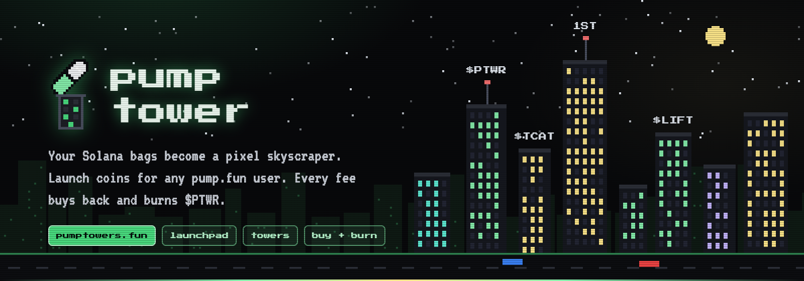
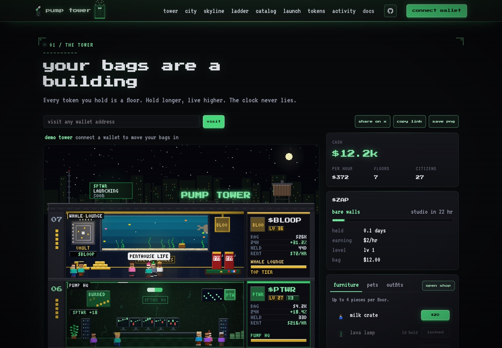
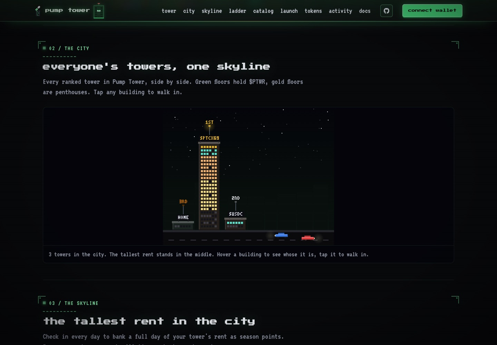
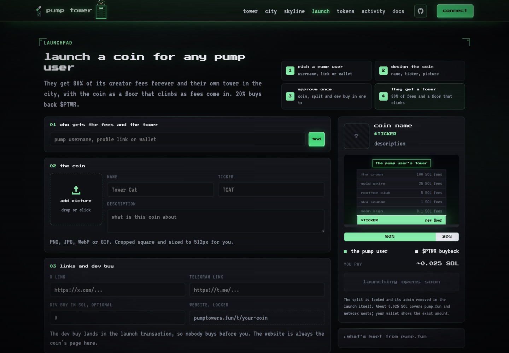
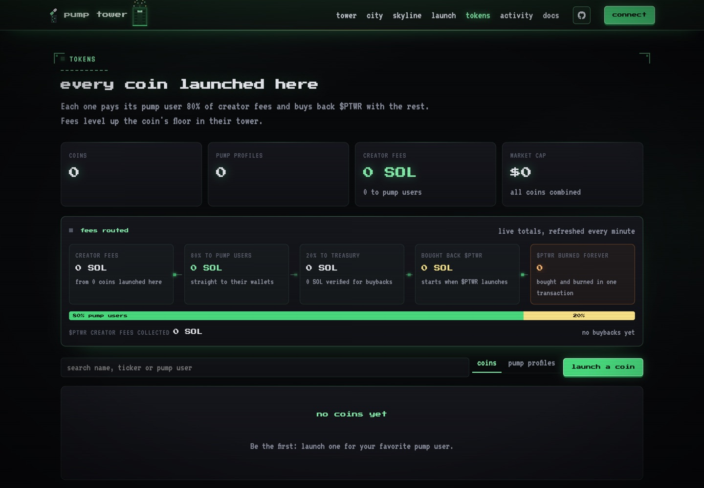
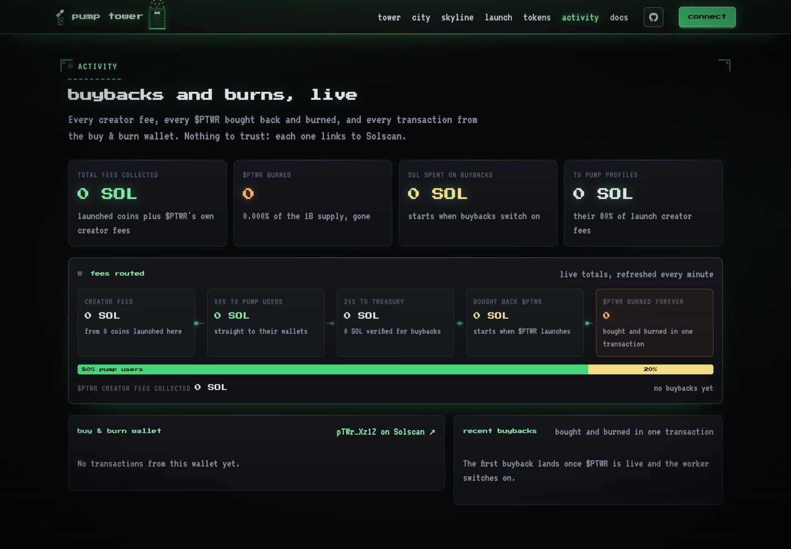
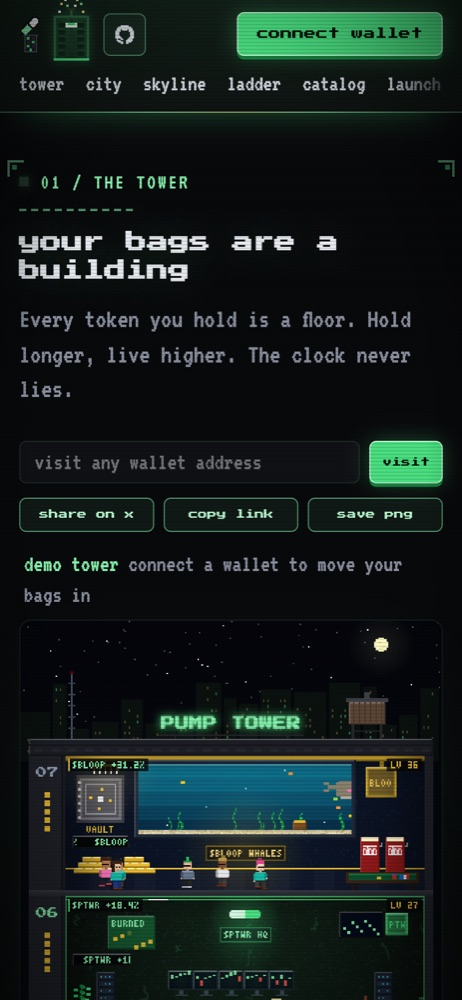
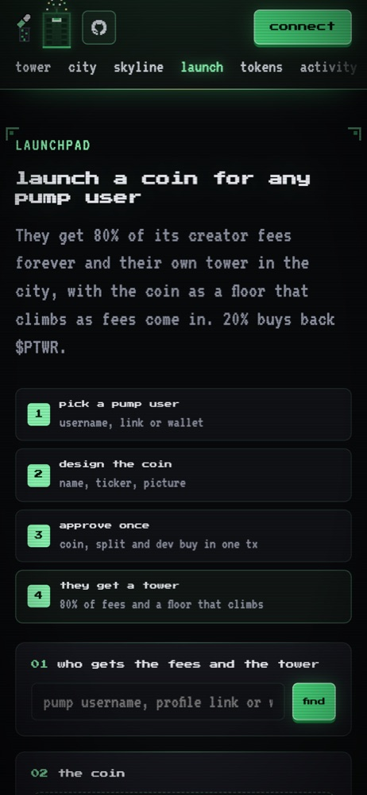
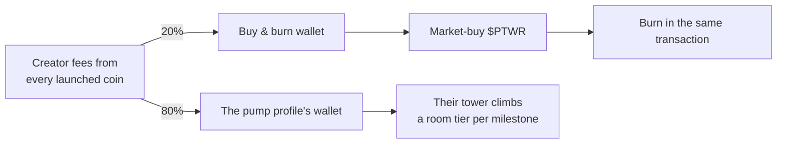

<p align="center">
  <a href="https://pumptowers.fun"></a>
</p>

<p align="center">
  <a href="https://pumptowers.fun"><b>pumptowers.fun</b></a> ·
  <a href="https://pumptowers.fun/launch">launchpad</a> ·
  <a href="https://pumptowers.fun/tokens">tokens</a> ·
  <a href="https://pumptowers.fun/activity">activity</a> ·
  <a href="https://pumptowers.fun/#docs">docs</a> ·
  <a href="https://x.com/PumpTowerz">x</a>
</p>

# pump tower

Pump Tower turns any Solana wallet into a pixel skyscraper, and turns pump.fun creator fees into a city.

- **Your bags are a building.** Every token a wallet holds is a floor. The longer you hold, the fancier the floor and the more game cash it earns for furniture, pets and outfits.
- **Launch a coin for any pump user.** Pick a pump.fun profile and launch a coin for them in one wallet approval. They get 80% of its creator fees forever, plus their own tower in the city with the coin as a floor that levels up as fees roll in.
- **Every fee buys and burns $PTWR.** The other 20% goes to a public buy & burn wallet that market-buys $PTWR and burns it in the same transaction. Track every SOL and every burn live on the [activity page](https://pumptowers.fun/activity).

<p align="center">
  
</p>

| The city | The launchpad |
| --- | --- |
|  |  |
| **Tokens and pump profiles** | **Activity: buybacks and burns, live** |
|  |  |

<p align="center">
  
  &nbsp;&nbsp;
  
</p>

## Features

**The tower**
- Floors for every listed coin worth $0.50 or more, ranked by hold time: bare walls on day zero, studio at 1 day, apartment at 3, loft at 7, suite at 14, penthouse at 30.
- Themed rooms with live coin logos, colours and prices, citizens who talk about the coin, rain on red days and fireworks on green ones.
- Every floor shows the bag it holds: a logo-stamped sack that grows with the bag, a ticker flag, a coin plush at a week, a diamond hands trophy at a month, and a rocket or HODL sign with the day's move.
- Game cash from rent (derived from on-chain hold time, so it can't be faked), a daily check-in streak, daily quests and invite rewards.
- A catalog of 49 furniture pieces, pets and outfits, from the airdrop crate and pump pill to the lambo and golden phoenix; the best items unlock only on long-held floors.
- A free home floor for every signed-in resident, weekly seasons, all-time leaderboards and achievements.
- Visit any wallet with `?w=<address>`, share to X, copy a link or save the tower as a PNG.

**The city and skyline**
- Every ranked tower side by side, lit by tier. Green floors hold $PTWR, gold floors are penthouses, and launch signs hang off towers that have coins launched for them.

**The launchpad** ([/launch](https://pumptowers.fun/launch))
- Find any pump.fun user by username, profile link or wallet.
- Design the coin: drag-and-drop logo, name, ticker, description, X and Telegram links, and an optional dev buy.
- One approval creates the coin, locks the 80/20 creator-fee split (its admin is removed in the same transaction) and makes the dev buy, so nobody buys before you.
- On confirm, the pump user's tower goes up in the city straight away, with the coin as a floor that climbs a room tier at 0.1, 1, 5, 25 and 100 SOL of lifetime fees.

**Tokens and pump profiles** ([/tokens](https://pumptowers.fun/tokens))
- Every coin launched here with its logo, fee tier, creator fees, market cap and 24h volume.
- Totals across all coins: coins, pump profiles, creator fees, 24h volume and market cap.
- A pump profiles tab with each user's picture, coins, fees, earnings, combined market cap and volume, latest launch and top coin.

**Activity** ([/activity](https://pumptowers.fun/activity))
- A fees-routed tracker following every fee from creator fees to burned $PTWR.
- Live totals: fees collected, $PTWR burned and its share of supply, SOL spent on buybacks, SOL paid to pump profiles.
- The buy & burn wallet's transactions, labelled and linked to Solscan, plus every recent buyback.

## $PTWR

$PTWR is the game's coin. There are no holder rewards; its value comes from buybacks, burns and what it does in the game.

- **Buybacks:** 20% of the creator fees of every coin launched on the launchpad go to the buy & burn wallet.
- **Burns:** every $PTWR bought back is burned in the same transaction, so supply only goes down.
- **In game:** holding $PTWR adds a neon Pump HQ floor that earns 3x the rent of any other bag.



| Wallet | Address |
| --- | --- |
| Buy & burn (treasury) | [`pTWrBR7VzpAzztwYaLnot5sxP4a9tBJjyi1CLF4Xz1Z`](https://solscan.io/account/pTWrBR7VzpAzztwYaLnot5sxP4a9tBJjyi1CLF4Xz1Z) |
| Dev | [`pTwRp9D2oRe1iSjCpKgoyu1Pe7LYD5zYNZHU3Hid4e1`](https://solscan.io/account/pTwRp9D2oRe1iSjCpKgoyu1Pe7LYD5zYNZHU3Hid4e1) |

## Stack

Next.js 16 and React 19 on Vercel, Upstash Redis, Solana web3.js with the pump.fun SDKs, Helius and DexScreener for chain and price data. All art is original pixel art drawn procedurally on canvas.

## Run

```
npm install
npm run dev     # http://localhost:3000
npm test        # game, launchpad and buyback rules
npm run build
```

## Deploy (Vercel)

Import `DylComp/pump-tower` into Vercel (framework Next.js, root directory left as is). Env vars:

| name | needed | what |
| --- | --- | --- |
| `HELIUS_API_KEY` | strongly recommended | Helius RPC for wallet reads and labelled activity. Without it the app uses PublicNode's free keyless RPC, which works but is slower. |
| `SOLANA_RPC_URL` | optional | any other RPC URL, used when no Helius key is set |
| `KV_REST_API_URL`, `KV_REST_API_TOKEN` | for saves, the city and the launchpad | added automatically by the Upstash for Redis integration (Vercel Storage). `UPSTASH_REDIS_REST_URL`/`_TOKEN` also work. Without them the game falls back to per-browser saves. |
| `CRON_SECRET`, `PTWR_*` | for buybacks and fee collection | see [Operations](#operations) |

`GET /api/health` reports whether the database and Helius key are wired up.

## How it works

- `app/api/tower` reads the wallet's SPL and Token-2022 accounts, drops NFTs, dust under $0.50 and unlisted spam, and prices them with DexScreener. Each floor's clock is the latest transaction where its token account went from empty to holding, so selling everything restarts it. Read only: nothing is ever signed.
- Cash is derived, not stored: every floor pays rent for each hour since launch (2026-10-18) at the tier it was in that hour, minus what the wallet has bought. The database only holds purchases and placements.
- Sign in is a free `signMessage` (no transaction). `/api/auth/nonce` issues a one-time nonce, `/api/auth/verify` checks the ed25519 signature against the wallet and sets a 30 day HMAC session cookie (the HMAC key is generated once and kept in Redis).
- `/api/buy` and `/api/remove` are server authoritative: they reload the tower (5 minute Redis cache), recompute cash and tier locks, and write under a per-wallet lock so two tabs can't double spend. `/api/save?w=` lets anyone see how a tower is decorated; only its signed-in owner can change it.
- `/api/leaderboard` ranks every tower that has been loaded or launched for by rent per hour, re-scored at read time since tiers keep climbing.
- The launchpad builds the launch transaction server side (`/api/launch/prepare`), the browser checks every program it calls before signing, and `/api/launch/confirm` reads the coin back off chain and lists it only if the 80/20 split is locked. Confirming also builds and ranks the pump user's tower. A launch is too big for one transaction without an address lookup table, so the site's very first launch also creates and freezes that table in the same wallet approval (about 0.01 SOL extra, once); every later launch reuses it. Frozen means nobody, including whoever paid for it, can change or close it.
- `/api/tokens`, `/api/fees`, `/api/burns` and `/api/activity` feed the tokens, fees-routed and activity views. They only read the registry, the buyback and fee-collection ledgers and the chain; none of them write to a ledger or sign anything.
- `lib/game.ts` holds all rules (tiers, rent, item catalog, buying). `lib/render.ts` and `lib/sprites.ts` draw the tower and item icons. `lib/howto.ts` holds the in-site docs, with numbers read from the rules.

## Launch checklist

1. Launch $PTWR, then set `HOUSE_MINT` in `lib/game.ts` and `PTWR_OFFICIAL_MINT` in Vercel.
2. Provision and switch on buybacks and fee collection as described under [Operations](#operations).
3. Launch one coin for a real pump user and check it on /tokens, pump profiles, /activity and in the city.

## Known limits

- A tower joins the city when it is first opened or when a coin is launched for it, and its entry refreshes when it is next loaded.
- Very busy token accounts (more than 30 recent transactions) fall back to their oldest visible signature, which can only make a hold look shorter.

## Operations

### Treasury and buybacks

Profile launches permanently split creator fees 80% to the selected pump profile and 20% to the treasury. The scheduled worker at `/api/cron/buybacks` uses only verified, finalized distribution receipts from registered profile launches. It excludes `PTWR_OFFICIAL_MINT`, other coins, deposits, and main-coin creator fees. The treasury share is already 20%; it is not reduced to 20% again. Network costs consume a small part of the buyback budget. Collection gas is paid by the treasury.

The official PTWR coin is planned with standard creator fees. Its own creator fees are never collected by this worker.

The worker runs every five minutes on Vercel, with an authenticated `CRON_SECRET`. It is deployed disabled, awaiting the official mint. It never guesses the mint from a ticker or metadata. Signing keys are production-only sensitive environment variables: the treasury key is used only by the buyback worker, and the dev key only by the separate dev-fee collector.

| Variable | Value |
| --- | --- |
| `PTWR_OFFICIAL_MINT` | Exact official mint, unset before launch |
| `PTWR_BUYBACK_ENABLED` | `false` until activation checks pass |
| `PTWR_TREASURY_SECRET_KEY` | JSON Solana keypair array, sensitive, server-only |
| `CRON_SECRET` | Random bearer secret, sensitive |

Revenue-mode sizing: each buy uses the maximum verified unspent profile-fee revenue allowed by the wallet balance, retaining 0.02 SOL for operations and reserving up to 0.009 SOL for transaction/account overhead. There is no fixed per-buy or daily spending cap in revenue mode; the legacy maxInput/dailyCap policy fields apply only to fixed-input mode. Slippage remains limited to 1%. Unrelated deposits and official-token creator fees never enlarge the verified revenue budget. Actual confirmed debits settle the ledger. Standard and Holder Rewards SOL Pump curves and canonical Pump AMM pools are supported; unsupported token extensions/modes halt execution. Holder Rewards creators must match the official per-mint rewards PDA. Cashback and mayhem target coins are rejected. Buy and burn are in one atomic transaction.

Before activation:

1. Confirm the official mint and its supported on-chain settings. Set `PTWR_OFFICIAL_MINT` in production and update `HOUSE_MINT` in `lib/game.ts` for the UI at launch. Do not change a mint once the ledger has pinned it.
2. Fund the treasury with operational SOL separately from fee revenue. Set `PTWR_TREASURY_ADDRESS` locally to its public address and `PTWR_TREASURY_KEY_FILE` to its private keypair file. With the production RPC and official mint configured, run `node scripts/provision-buyback.mjs` to simulate provisioning, then `node scripts/provision-buyback.mjs --execute` to create its token ATA and AMM volume account.
3. Enable `PTWR_BUYBACK_ENABLED=true` and redeploy only after provisioning and mint compatibility checks. Check a first small finalized buy/burn receipt.

Redis stores the fenced worker lease, pinned mint, receipt credits, confirmed debits, last buyback receipt and pending signed attempts under `pt:buyback:v1`. Signed attempts are persisted before submission; retries send identical bytes. An expired attempt with no finalized receipt stays unresolved and holds new execution. Investigate with an archival RPC; never delete the pending attempt or reset the ledger to retry blindly. A missing/pruned fee receipt holds the scan cursor. Receipt IDs and credits commit atomically. To pause, set `PTWR_BUYBACK_ENABLED=false` and redeploy; already broadcast transactions can still finalize.

Atomic curve/AMM plan construction and verification are adapted from the user's FUB project. New tests cover revenue exclusions, budget boundaries, and rejection of altered buy/burn transactions. No real purchase can be tested before the official mint exists.

### Automatic dev creator-fee collection

`/api/cron/dev-fees` runs every five minutes, offset two minutes from buybacks. It claims standard SOL creator fees into the configured dev wallet, with no transfer to treasury and no purchase or burn. It validates that the official mint (and canonical pool after graduation) names the dev wallet as creator; shared-fee, Holder Rewards, cashback, mayhem and non-SOL configurations are refused. It sweeps newer curve/pool creator-fee buckets before collecting. Creator vaults are wallet-scoped: fees already in those vaults can include other coins using this same creator wallet. It sweeps only the configured official mint's unclaimed curve/pool buckets.

Production variables: `PTWR_DEV_SECRET_KEY` (sensitive JSON keypair) and `PTWR_DEV_FEE_COLLECTION_ENABLED=true`. The existing `PTWR_OFFICIAL_MINT`, RPC and `CRON_SECRET` are shared. With no official mint it returns `awaiting_official_mint` without loading a key or sending anything. Claims require at least 0.001 SOL in a source and a dev balance of at least 0.01 SOL for gas/rent, and simulation must show positive net proceeds. Curve and AMM claims alternate when both have sufficient fees. AMM fees are unwrapped through a fresh temporary token account, created and closed atomically; the dev wallet's existing WSOL account is untouched.

The independent `pt:dev-fees:v1` ledger pins the mint and dev address, stores signed attempts before broadcasting, records finalized net proceeds, and caps network fees at 0.0001 SOL per attempt and 0.001 SOL per UTC day. A pending attempt is retried with identical signed bytes; expired attempts lacking a finalized receipt stop for reconciliation. This ledger never credits the buyback budget. Set `PTWR_DEV_FEE_COLLECTION_ENABLED=false` and redeploy to pause new collections. Previously broadcast transactions may still finalize.

### Profile fee claims before the official mint launches

`/api/cron/profile-fees` runs every minute independently of `PTWR_OFFICIAL_MINT`
and `PTWR_BUYBACK_ENABLED`. Set `PTWR_PROFILE_CLAIMS_ENABLED=true` and fund the
configured treasury signer (0.01 SOL is enough to start). It visits registered
coins in rotation, verifies the locked 80% profile recipient / 20% treasury split,
and uses the official SDK to sweep and distribute creator fees. One transaction
can be in flight at a time; signed bytes are saved before broadcast and reused
on retries. A finalized receipt is reconciled on a later invocation. Unresolved
expired transactions halt collection for inspection. The separate ledger is
`pt:profile-fees:v1`, pinned to the treasury wallet rather than the future mint.

Claims require at least 0.002 SOL in the fee payer, cap the transaction network
fee at 0.0001 SOL, and require a simulated net treasury gain of 0.0001 SOL.
Official-token fees are excluded. Buybacks and official dev claims remain on
separate five-minute schedules, awaiting the official mint. Successful finalized claims immediately invalidate and refill the affected fee
total from on-chain distribution receipts, before clearing the pending claim.
The fee tracker, coin and profile pages poll every five seconds. The token list
also polls, with a longer interval when many pages are loaded. Background
reconciliation retains a ten-minute cache for payouts made outside the worker;
treasury activity refreshes within a minute. Treasury deposits for gas never count as buyback revenue.
