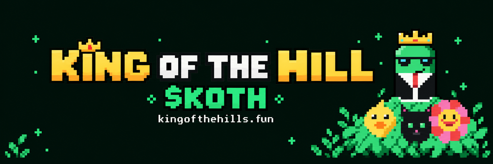

# King of the Hill



**One KOTH token. Back your king.**

[Live site](https://www.kothcoins.fun) · [Worker documentation](docs/king-worker.md) · [Launch checklist](docs/king-launch.md)

Track 100 squads through public mirrors of Pump competition standings. Rankings and 30-minute winner selection remain unverified. KOTH creator fees fund the original reward system:

| Allocation | Destination |
| --- | --- |
| 40% | Winning squad: registered members equally, otherwise squad creator |
| 40% | Eligible KOTH holders backing the winning squad, proportional to snapshot holdings |
| 20% | Proportional SOL airdrops to KOTH holders worth more than $1 |

KOTH is currently **prelaunch**. Financial processing is disabled until rankings, 30-minute winner selection, its public mint and on-chain creator-fee route are verified. There are no active squad tokens and no squad-token launches.

## Architecture

Next.js on Vercel, durable Redis journals, finalized Solana receipt verification. A five-minute scanner tracks squads; a one-minute worker collects KOTH fees, snapshots eligible supporters and settles 30-minute allocations. Signing keys remain in environment variables. Unallocated rewards retain their original categories; no deposit is counted as fee revenue.

## Development

```sh
npm install
npm run dev
npm run typecheck
npm test
npm run build
```

See the worker documentation for custody, eligibility, reserves, retries and acceptance criteria. Never commit environment files or private keys.

## Brand assets

- [Profile logo](public/brand/koth-avatar.png)
- [X banner](public/brand/koth-x-banner.png)

The implementation evolved from Pump Tower; retained historical metadata does not represent active squad coins or PTWR rewards.
